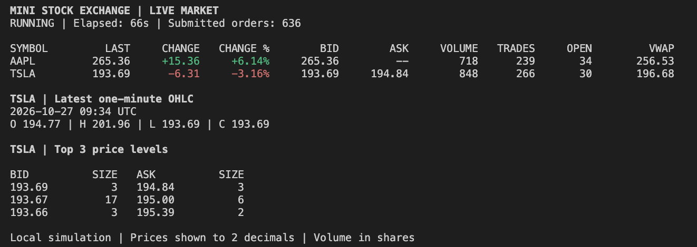

# MiniStockExchange

A concurrent Java stock-exchange simulator with price-time matching, limit/market orders, partial fills, amendments, cancellation, and a PostgreSQL-backed REST API.

**Current state:** V3 backend and the public React market dashboard implemented. Account/trading screens, live web updates, and deployment are next.

Java 17+ · Maven · Spring Boot · Spring Security · PostgreSQL 17 · JPA/Hibernate · Flyway · JUnit

## Project evolution

These are milestones of the **same project**, not separate applications or release tags:

| Milestone | What it added |
| --- | --- |
| **V1 — Matching core** | Price/FIFO priority, partial fills, trades, cancellation, statistics, unique IDs, and thread safety. |
| **V2 — Multi-stock simulator** | Amendments, multiple stocks, market orders, lifecycle status, indexed lookup, depth, VWAP, OHLC, price changes, simulator, and console dashboard. |
| **V3 — Persistent web backend** | PostgreSQL, users, session authentication, admin controls, secured trading APIs, restart recovery, delta persistence, and public market-data APIs. Stock selection, summaries, depth, recent trades, and candlestick charts ready; account/trading screens pending. |

Flyway migration numbers (`V1__...`, etc.) are separate from these milestones. The Maven artifact remains `1.0.0-SNAPSHOT`.



*V2 console demo. It uses separate in-memory markets; it does not populate the V3 database or APIs.*

## Features and architecture

- Price-time matching at the resting order's price, with FIFO queues and partial fills.
- Market orders execute available liquidity and cancel their remainder.
- Amendments preserve priority for same-price reductions; price changes/increases lose priority.
- Session login, CSRF protection, user-owned orders, and admin overrides.
- Atomic order/trade persistence, restart recovery, and failure reconciliation.
- Public snapshots, depth, paginated trades, and UTC one-minute candles.

```text
TradingController / MarketDataController
                  ↓
            TradingService
         global synchronization
            ↙           ↘
     MatchingEngine   PostgreSQL
      current book    durable history
```

Packages: `auth/` security, `user/` accounts, `stock/` metadata, `trading/` commands/persistence/recovery, and `marketdata/` public read APIs. Root classes contain the matching core, console demo, and Boot entry point. Tests mirror the feature packages.

## Quick start

Requires **JDK 17+ and PostgreSQL 17**, with separate development/test databases. For a fresh checkout:

```bash
git clone https://github.com/xMisho/MiniStockExchange.git
cd MiniStockExchange
cp .env.example .env
chmod 600 .env
```

Set `DB_USERNAME`, `DB_PASSWORD`, `DB_URL`, and `DB_TEST_URL` in `.env`; database creation instructions are below. Do not overwrite an existing working `.env`.

```bash
./mvnw clean verify
./mvnw spring-boot:run
```

Check `http://localhost:8080/api/health`. Stop with **Ctrl+C**. Use `mvnw.cmd` on Windows.

Fresh databases have no seeded users/stocks/trades. Register an account, promote an administrator explicitly, register stocks, then submit orders. Empty market responses are expected before activity. No external live prices are fetched.

For the separate console demo, after building:

```bash
java -Ddashboard.clear=true -cp target/mini-stock-exchange-1.0.0-SNAPSHOT.jar com.misho.exchange.Main 30 100 42 TSLA
```

Arguments: duration in seconds, order interval in milliseconds, random seed, selected stock. Defaults: `10 100 42 AAPL`.

## Frontend development

The React + TypeScript app lives in `frontend/`, with Vite, strict type checking, plain CSS, and a public market dashboard. It selects the first registered stock and displays its summary, top-five depth, latest ten trades, and latest hundred one-minute candlesticks. Login/trading controls are not implemented yet. Use **Node 24 LTS** (see `frontend/.nvmrc`). Frontend files stay independent of the Maven backend; there are no Java package or database schema changes in this step.

Start Spring from the repository root in one terminal:

```bash
./mvnw spring-boot:run
```

In another terminal:

```bash
cd frontend
npm ci
npm run dev
```

Open **http://localhost:5173**. Vite forwards relative `/api` requests to `http://localhost:8080`; the browser uses the frontend origin, and Spring's existing authentication/CSRF rules remain unchanged. Stock-list and summary requests have loading/error/retry states and an eight-second timeout. An empty list shows a registration prompt. Missing prices display as `—`, zero counters as `0`, and changes use signed green/red formatting. Selecting a different stock cancels the previous request; obsolete responses cannot replace the selected summary. Each panel loads independently on selection, cancels obsolete requests, and retries only its own failures. Trades show explicit UTC times in backend trade-ID order. Charts preserve chronological candles, omit idle minutes, and include an expandable OHLC/volume table. Lightweight Charts provides candlesticks with TradingView attribution (see `frontend/THIRD_PARTY_NOTICES.md`). Summary, depth, and recent trades refresh two seconds after each request completes; candles refresh after ten seconds. Each panel keeps its previous data visible during refresh and shows its last successful UTC update time. Failures show a subtle stale-data warning with a panel-only retry. Requests never overlap within a panel. Hidden tabs pause polling and cancel pending reads; returning to the tab refreshes immediately. Stock switching and unmounting cancel requests and timers. The stock list loads initially or on retry; it is not polled.

Frontend code is grouped into `api/` requests/validation, `types/` contracts, `components/` stock list and summary, `pages/` dashboard state, and `utils/` display formatting. API tests run in Node; React interaction tests run in jsdom, including rapid switching and unmount cleanup.

To use a different development backend, copy `frontend/.env.example` to `frontend/.env.local`, set `BACKEND_URL`, and restart Vite. This server-only setting is not bundled into the browser. Frontend env files stay separate from the root `.env`; never place database passwords in `VITE_*` variables.

```bash
npm run typecheck
npm run lint
npm test
npm run build
```

`npm run preview` serves the built static files on port 4173 for inspection; it does not configure an API proxy. Production hosting and API routing will be added with deployment. Both development servers bind to localhost. Dependencies are locked in `frontend/package-lock.json`; generated `node_modules/` and `dist/` are ignored by Git.

## REST API

Public GETs require no login or CSRF. All mutations require CSRF; trading requires login, and stock registration requires ADMIN. Login is form-encoded; other request bodies are JSON.

| Method | Path | Access / purpose |
| --- | --- | --- |
| GET | `/api/health` | Public web health |
| GET | `/api/auth/csrf` | Public token/header-name lookup |
| POST | `/api/users` | Public user registration |
| POST | `/api/auth/login` | Public form-encoded login |
| GET | `/api/auth/me` | Authenticated profile |
| POST | `/api/auth/logout` | CSRF-protected session logout |
| GET | `/api/stocks` | Public metadata list, sorted by symbol |
| GET | `/api/stocks/{symbol}` | Public stock metadata |
| POST | `/api/stocks` | ADMIN-only stock registration |
| GET | `/api/stocks/{symbol}/snapshot` | Public current market summary |
| GET | `/api/stocks/{symbol}/depth` | Public aggregated resting quantities |
| GET | `/api/stocks/{symbol}/trades` | Public paginated committed executions |
| GET | `/api/stocks/{symbol}/candles` | Public execution-derived one-minute OHLC |
| POST | `/api/stocks/{symbol}/orders` | Authenticated order submission |
| GET | `/api/orders/me` | Authenticated caller's paginated history |
| GET | `/api/orders/{id}` | Owner or ADMIN lookup |
| PATCH | `/api/orders/{id}` | Owner or ADMIN amendment |
| DELETE | `/api/orders/{id}` | Owner or ADMIN cancellation |

## Testing and performance

```bash
./mvnw clean verify
./mvnw -Dtest=TradingBenchmarkTest -Dtrading.benchmark=true test
```

Integration tests use real PostgreSQL in `DB_TEST_URL`; the opt-in benchmark is skipped in normal runs. Coverage includes matching, security, ownership, pagination, market data, concurrency, transaction failures, and restart recovery.

Local median latency at **20,000 historical orders / 10,000 trades**:

| Operation | Before → after delta persistence |
| --- | ---: |
| Submit | 176.371 → 1.159 ms |
| Amend | 166.812 → 4.271 ms |
| Cancel | 154.125 → 3.909 ms |
| Executing market order | 179.097 → 6.939 ms |

Measured 2026-10-29 with five warmup and ten measured cycles; baseline `5dee98c`. Local results demonstrate reduced history-replay cost, not a production throughput guarantee.

## Important limits

- **One active backend writer.** Global synchronization remains intentional; cached engines are not coordinated across instances.
- A failed mutation may already have committed. On `TRADING_OUTCOME_UNCERTAIN` / `retrySafe: false`, inspect history before retrying. No request-idempotency keys yet.
- Recovery failure blocks that market. Historical reads remain available if PostgreSQL works.
- Engine history grows in memory; depth/candle query work is not fully bounded by response limits.
- No balances, portfolios, settlement, real exchange connectivity, or external price feed.
- Local development only for now. Dashboard/account/trading screens, SSE, Docker deployment, and further production hardening remain planned.

## Detailed guides

Expand only what you need:

<details>
<summary>PostgreSQL setup and backend launch</summary>

##### Requirements

- JDK 17 or newer.
- PostgreSQL 17 running locally, with separate development and test databases.
- The Maven wrapper downloads Maven on first use; a separate Maven installation is optional.
- `curl` and Python 3 for the optional terminal walkthrough below.

Clone the repository:

```bash
git clone https://github.com/xMisho/MiniStockExchange.git
cd MiniStockExchange
```

For a **new PostgreSQL installation**, connect using an authorized database administrator:

```bash
psql -d postgres
```

Create the application login and databases. `\password` prompts instead of embedding the password in SQL history:

```sql
CREATE ROLE mini_stock_exchange LOGIN NOSUPERUSER NOCREATEDB NOCREATEROLE;
\password mini_stock_exchange
CREATE DATABASE mini_stock_exchange OWNER mini_stock_exchange;
CREATE DATABASE mini_stock_exchange_test OWNER mini_stock_exchange;
\q
```

For a fresh checkout, create your private configuration, then edit `.env` and replace its password placeholder:

```bash
cp .env.example .env
chmod 600 .env
```

Do not overwrite an existing working `.env` or recreate databases you already use.

| Variable | Purpose |
| --- | --- |
| `DB_URL` | Application JDBC URL; defaults to `jdbc:postgresql://localhost:5432/mini_stock_exchange` |
| `DB_TEST_URL` | Integration-test URL; defaults to `jdbc:postgresql://localhost:5432/mini_stock_exchange_test` |
| `DB_USERNAME` | Application database login; defaults to `mini_stock_exchange` |
| `DB_PASSWORD` | Password for that database login, not a web user's password |
| `SESSION_COOKIE_SECURE` | Set to `true` when serving over HTTPS; defaults to `false` for local HTTP |

Launch from the repository root so Spring can read `.env`, or supply environment variables explicitly. Environment variables override file values. `.env` is ignored by Git; `.env.example` contains placeholders only. No real accounts, credentials, or database records are distributed in the repository.

On the original Apple Silicon/Homebrew installation, the server can be controlled with:

```bash
/opt/homebrew/opt/postgresql@17/bin/pg_ctl -D /opt/homebrew/var/postgresql@17 -l /opt/homebrew/var/postgresql@17/server.log -w start
/opt/homebrew/opt/postgresql@17/bin/pg_ctl -D /opt/homebrew/var/postgresql@17 -m fast -w stop
```

Other installations should use their own PostgreSQL service controls. Only stop a server when other local applications no longer need it. pgAdmin is an optional visual client, not a server dependency; tables are under `mini_stock_exchange → Schemas → exchange → Tables`.

##### Run the web backend

```bash
./mvnw spring-boot:run
```

Open these public endpoints:

```bash
curl http://localhost:8080/api/health
curl http://localhost:8080/api/stocks
```

The health response is `{"status":"UP"}`. It checks web responsiveness, not continuous database health. Startup requires PostgreSQL, valid migrations, and successful market recovery. There is no page at `/` yet. Stop Spring with **Ctrl+C**; PostgreSQL continues running separately.

Build and run the packaged backend:

```bash
./mvnw clean verify
java -jar target/mini-stock-exchange-1.0.0-SNAPSHOT-boot.jar
```

Use `mvnw.cmd` instead of `./mvnw` on Windows. Integration tests require the dedicated test database; there is no H2 fallback.

</details>

<details>
<summary>Registration, session login, CSRF, and administrator setup</summary>

The backend uses Spring Security **session cookies**, not JWTs. Usernames and emails are trimmed and normalized to lowercase. Usernames accept 3–50 letters/digits/underscores; email format is validated but ownership is not verified. Passwords are preserved exactly, must contain 15–128 characters, and must not be entirely blank.

Passwords are hashed before storage with PBKDF2-HMAC-SHA256, 600,000 iterations, a random 16-byte salt, and a 256-bit derived key. Responses never expose raw passwords or hashes. Authentication loads credentials from PostgreSQL and checks the stored hash through Spring Security.

Registration creates a `USER`; it does not log the account in. Supplying a role in the registration payload cannot create an administrator.

##### Terminal walkthrough

Use the same terminal for these commands so the cookie/token variables stay available. Example credentials below are demonstration data only.

Get a session and CSRF token:

```bash
COOKIE_JAR=$(mktemp)
CSRF_TOKEN=$(curl -sS -b "$COOKIE_JAR" -c "$COOKIE_JAR" http://localhost:8080/api/auth/csrf | python3 -c 'import json,sys; print(json.load(sys.stdin)["token"])')
```

Register, then log in. Registration is JSON; login is form-encoded:

```bash
curl -i -b "$COOKIE_JAR" -c "$COOKIE_JAR" http://localhost:8080/api/users \
  -H "X-CSRF-TOKEN: $CSRF_TOKEN" -H 'Content-Type: application/json' \
  -d '{"username":"example_user","email":"example_user@example.test","password":"ExampleOnlyPassword123!"}'

curl -i -b "$COOKIE_JAR" -c "$COOKIE_JAR" http://localhost:8080/api/auth/login \
  -H "X-CSRF-TOKEN: $CSRF_TOKEN" \
  --data-urlencode 'username=example_user' \
  --data-urlencode 'password=ExampleOnlyPassword123!'
```

Login uses the username, not email. On success, it rotates the session ID and invalidates the old CSRF token. Fetch a fresh token before any subsequent write:

```bash
CSRF_TOKEN=$(curl -sS -b "$COOKIE_JAR" -c "$COOKIE_JAR" http://localhost:8080/api/auth/csrf | python3 -c 'import json,sys; print(json.load(sys.stdin)["token"])')
curl -i -b "$COOKIE_JAR" http://localhost:8080/api/auth/me
```

To create the first administrator, an authorized operator must promote an existing account in the development database:

```sql
UPDATE exchange.users SET role = 'ADMIN' WHERE username = 'example_user';
```

Log out and back in after promotion, then refresh CSRF again. Roles are captured at login; changing a database role does not update an existing session. No public role-management endpoint or automatic administrator exists.

Log out with the current token:

```bash
curl -i -b "$COOKIE_JAR" -c "$COOKIE_JAR" -X POST http://localhost:8080/api/auth/logout \
  -H "X-CSRF-TOKEN: $CSRF_TOKEN"
rm "$COOKIE_JAR"
```

Logout returns `204`, invalidates the session, and expires its cookie. Obtain a fresh anonymous token before logging in or registering again. Cookies are HttpOnly and SameSite=Lax, sessions expire after 30 minutes of inactivity, and sessions do not survive server restarts. URL session tracking and HTTP Basic are disabled.

</details>

<details>
<summary>API payloads, pagination, candle semantics, and errors</summary>

##### Stock metadata and trading

An authenticated ADMIN can register a stock using JSON:

```json
{"symbol":"AAPL","companyName":"Apple Inc.","referencePrice":100.00}
```

This is an illustrative reference price, not a market quote. Symbols normalize to uppercase. Duplicate registration returns `409` and cannot overwrite an existing stock. Prices must fit `NUMERIC(19,4)` exactly; values requiring rounding are rejected. Fresh databases are empty, and the application does not fetch external prices. Reference price is separate from last executed price.

After logging in, this command submits a resting SELL order for an already registered symbol:

```bash
curl -i -b "$COOKIE_JAR" http://localhost:8080/api/stocks/AAPL/orders \
  -H "X-CSRF-TOKEN: $CSRF_TOKEN" -H 'Content-Type: application/json' \
  -d '{"side":"SELL","type":"LIMIT","limitPrice":101.00,"quantity":5}'
```

Submit a crossing BUY to execute against it:

```json
{"side":"BUY","type":"LIMIT","limitPrice":105.00,"quantity":2}
```

Submission returns `201` with the resulting order and a `Location: /api/orders/{id}` header. Database-generated IDs are used by the engine. Ownership always comes from the login session, never a client-supplied owner ID. Public order responses omit internal FIFO priority and optimistic-lock versions.

Market orders have no limit price:

```json
{"side":"BUY","type":"MARKET","quantity":5}
```

They execute against available opposite-side limits, best price first, and cancel unfilled remainder. They never rest in the book.

Amend an open limit order with PATCH:

```json
{"newPrice":102.00,"newRemainingQuantity":3}
```

Quantity means **new remaining quantity**, not original quantity. Original quantity and creation timestamp remain historical. Same-price reductions keep FIFO position; increases or price changes move the order to the back. A same-price/same-quantity amendment succeeds as a no-op. Crossing amendments match immediately. Zero quantity is invalid; use cancellation instead. Amendment/cancellation returns `204`, or `409` for a terminal order.

`/api/orders/me?page=0&size=25&status=OPEN` supports an optional `OPEN`, `PARTIALLY_FILLED`, `FILLED`, or `CANCELLED` filter. Results use descending order ID. Defaults are page 0 and size 25; size must be 1–100 and page nonnegative. Offsets beyond the persistence provider's integer range are rejected. The list always belongs to the caller, including for admins. Admins can separately inspect/amend/cancel another owner's order without changing ownership; ordinary users receive `403` for someone else's known order.

##### Snapshot and depth

```bash
curl http://localhost:8080/api/stocks/AAPL/snapshot
curl 'http://localhost:8080/api/stocks/AAPL/depth?levels=3'
```

Snapshot fields are `symbol`, `lastTradedPrice`, `priceChange`, `priceChangePercent`, `bestBidPrice`, `bestAskPrice`, `spread`, `volume`, `tradeCount`, `openOrderCount`, and `vwap`. The dedicated response DTO omits internal depth/candle fields.

Last price changes only on execution. Price change is last price minus reference price; percentage change uses the reference as denominator. This is not necessarily a daily change. VWAP is the sum of execution price × executed quantity divided by total quantity, rounded to four decimals. Executed volume counts shares once per trade, not both sides. Open-order count counts orders, not shares.

Before trading, last price/change/VWAP are null. Quotes can exist without trades; missing sides are null, and spread is null unless both sides exist. An entirely empty market has zero counters.

Depth response:

```json
{"symbol":"AAPL","bids":[{"price":99.00,"quantity":12}],"asks":[{"price":101.00,"quantity":8}]}
```

Bids descend and asks ascend by price. Quantities are `long` sums of remaining shares at each numeric price. `levels` defaults to 3 and must be 1–100 per side. Empty sides return `[]`. Both sides come from one immutable snapshot under the service monitor. Responses are bounded, although the internal snapshot still aggregates the full open book.

##### Trade history and candles

```bash
curl 'http://localhost:8080/api/stocks/AAPL/trades?page=0&size=25'
curl 'http://localhost:8080/api/stocks/AAPL/candles?limit=100'
curl 'http://localhost:8080/api/stocks/AAPL/candles?from=2026-10-30T09:00:00Z&to=2026-10-30T10:00:00Z&limit=100'
```

Order history and trade history use the same pagination envelope:

```json
{"content":[],"page":0,"size":25,"totalElements":0,"totalPages":0}
```

Public trade items contain only `tradeId`, `symbol`, `executionPrice`, `quantity`, and `executedAt`. They never expose order or user IDs. Ordering is **trade ID descending**, even when execution timestamps tie or move backward. Page/size rules match order history. Empty histories and pages beyond the end return `200` with empty content. New inserts can shift offset-based pages between requests; pagination is not a fixed historical snapshot.

Candle response:

```json
[{"startTime":"2026-10-30T09:00:00Z","open":100.00,"high":103.00,"low":99.00,"close":102.00,"volume":20,"tradeCount":4}]
```

Candles are derived from PostgreSQL trades, with no separate candles table:

- UTC minute buckets; idle minutes are omitted.
- Open/close use first/last execution by `(executed_at, trade_id)`, with ID breaking timestamp ties.
- High/low are maximum/minimum price; volume sums quantities and trade count counts executions. Both counters use `long`.
- Optional ISO-8601 `from`/`to` accept UTC or explicit offsets. From is inclusive, to exclusive, and `from < to` when both exist.
- Execution filtering happens **before** aggregation: a partial-minute window represents only trades in that window.
- Limit defaults to 100, accepts 1–1000, and selects the **latest** buckets before returning them chronologically.
- No matching trades returns `200 []`. The current minute can still change; no final-candle flag is supplied.
- Bounds are within UTC calendar years 1–9999. Finer-than-microsecond bounds round upward for comparisons against PostgreSQL's microsecond timestamps.

Unlike the engine's execution-sequence candle replay, this historical API uses timestamp order if clocks move backward. Trade history and candles read committed PostgreSQL records and remain available when a live engine is blocked, provided the database works. Symbols are case-insensitive across market-data endpoints.

##### Errors and retries

| Status | Meaning |
| --- | --- |
| `400` | Invalid payload, symbol, pagination, or time range |
| `401` | Authentication required / invalid login |
| `403` | Ownership/access denied or missing/invalid CSRF |
| `404` | Unknown stock/order |
| `409` | Duplicate registration or amendment/cancellation of a terminal order |
| `503` | Market/database unavailable, or uncertain trading outcome |

A mutation failure can occur **after PostgreSQL committed**. The response then uses `TRADING_OUTCOME_UNCERTAIN` with `retrySafe: false`. Check your order history and relevant order before retrying; no automatic retry or request-idempotency key is implemented. A lost HTTP response can also hide a successful submission. If durable history cannot be read, wait for recovery rather than blindly resubmitting.

</details>

<details>
<summary>File organization, database integrity, and recovery guarantees</summary>

Source lives under `src/main/java/com/misho/exchange/`; tests mirror feature packages under `src/test/java/com/misho/exchange/`.

| Package / files | Responsibility |
| --- | --- |
| Root matching classes | Framework-independent `Order`, `OrderBook`, `Trade`, `MatchingEngine`, `Stock`, `Exchange`, enums, and immutable snapshots |
| Root console classes | `Main`, `MarketSimulator`, `ConsoleDashboard`; standalone simulation and rendering |
| Root Boot entry / health | `MiniStockExchangeApplication`, `HealthController` |
| `auth/` | Spring Security session rules, login/logout wiring, CSRF, current-user endpoint |
| `user/` | Registration, password configuration, database credentials/roles, safe user responses |
| `stock/` | Stock metadata entity, repository, service, validation, and REST API |
| `trading/` | Order/trade persistence, authenticated commands, ownership, transactions, engine registry, and recovery |
| `marketdata/` | Public read controller, DTOs, error handling, and SQL candle aggregation |
| `src/main/resources/db/migration/` | Append-only Flyway schema/index migrations |
| `src/test/.../support/` | HTTP session/CSRF test client |
| `assets/` | README dashboard screenshot |

```text
Authenticated commands ── TradingController ──┐
                                             ▼
                                     TradingService
                                  global synchronization
                                     /           \
                          MatchingEngine       PostgreSQL
                           current book       orders + trades
                                             ▲
Public market data ── MarketDataController ────┘
                      snapshots/depth: engine
                      history/candles: database
```

Controllers stay thin and return DTOs. `TradingService` remains the coordination boundary for both paths, including historical reads. `CandleRepository` uses parameterized SQL; order/trade repositories use JPA. The matching core and console launcher retain their original package/API so existing console commands continue to work.

## Persistent trading and recovery

The highest bid and lowest ask match when prices cross. Each price level is a FIFO `ArrayDeque` inside a `TreeMap`. Executions use the resting order's price; partial fills leave remaining LIMIT quantity in the book. The ID index speeds open-order lookup; removal still scans the selected queue.

The web service holds one global monitor through validation, engine mutation, database commit, and recovery/publication. A PostgreSQL advisory transaction lock also serializes participating database transactions; lock waiting is limited to five seconds. Successful writes reuse the engine, fetch only affected rows, and persist the target, changed counterparties, and new trades atomically. They do not replay or copy all historical orders/trades.

**Invariant: whenever the service monitor is released, every available engine reflects committed database state.** PostgreSQL rollback cannot undo Java memory, so failure triggers reconstruction from actual committed history before releasing the monitor. Commit may already have succeeded; recovery does not reexecute the command. If reconstruction fails, the cached engine is removed and the market is blocked until explicit recovery or successful restart. Recovery is attempted for runtime exceptions and errors; process termination/resource exhaustion can still prevent in-process recovery.

Startup restores active LIMIT orders by `priority_sequence`, not creation time, preserving amendment priority. It reserves terminal IDs, restores quantities/status/timestamps, and replays trades for last price, volume, VWAP, and engine candles. Recovery does not create executions. It rejects crossed resting books, unfinished MARKET orders, invalid references, and fill totals inconsistent with trade history.

| Database object | Purpose |
| --- | --- |
| `exchange.stocks` | Symbol, company name, fixed reference price |
| `exchange.users` | ID, normalized username/email, password hash, registration time, role |
| `exchange.orders` | Owner, symbol, side/type, price, original/remaining/filled quantities, status, priority, timestamps, version |
| `exchange.trades` | Symbol, buy/sell order references, execution price/quantity/time |
| Priority sequence | Queue order across submissions and priority-losing amendments |

Original quantity remains historical after amendments, so it need not equal filled plus remaining. CANCELLED orders retain unfilled remaining quantity. Trade foreign keys enforce distinct BUY/SELL orders for the same stock. Order versions reject stale database updates. Engine fills use checked integer addition.

Flyway migrations: **V1** schema, **V2** stocks, **V3** users, **V4** roles, **V5** orders/trades, **V6** trade time-range index. Flyway records applied migrations in `public.flyway_schema_history`; add new migrations instead of editing applied ones. Hibernate validates the schema (`ddl-auto=validate`), Open Session in View is disabled, and Flyway clean is disabled.

This design supports **one active backend writer**. The advisory lock does not synchronize cached engines across multiple instances. All persisted trading must go through `TradingService`; direct repository/SQL changes during trading are unsupported except deliberate maintenance followed by recovery. The service rejects ambient transactions so a caller cannot later roll back data after publication.

</details>

<details>
<summary>Console controls and simulator behavior</summary>

Build first, then run the separate V2 simulation:

```bash
./mvnw package
java -Ddashboard.clear=true -cp target/mini-stock-exchange-1.0.0-SNAPSHOT.jar com.misho.exchange.Main 30 100 42 TSLA
```

| Argument | Meaning | Default |
| --- | --- | --- |
| First | Duration in seconds | `10` |
| Second | Interval between generated orders in milliseconds | `100` |
| Third | Random seed, with no unit | `42` |
| Fourth | Symbol shown in detail | `AAPL` |

The console creates AAPL/TSLA with illustrative reference prices 250/200. It generates approximately 75% LIMIT and 25% MARKET orders, with limits roughly ±1% around last execution or reference price. It fetches no external quotes. Generated IDs skip previously used IDs; a simulator-owned open-order cap cancels its oldest open order before another limit submission. The cap does not restrict other participants.

The dashboard refreshes each second, displays two-decimal prices/VWAP, a selected-stock UTC candle, and top-three depth. Live mode uses an alternate terminal screen; completion/Ctrl+C restores it. `-Ddashboard.clear=false` keeps scrolling logs. `NO_COLOR=1` or `-Ddashboard.color=false` disables color. Use an ANSI-capable terminal around 105 columns by 22 rows.

The plain JAR is launched by class name; the `-boot.jar` is the separate executable web server. `./mvnw package -DskipTests` can build the console without a database test run. Equal seeds reproduce serial order decisions for equal initial books and step counts; scheduled run counts and timestamps still depend on timing.

</details>

<details>
<summary>Test coverage and benchmark methodology</summary>

```bash
./mvnw clean verify
./mvnw -Dtest=TradingServiceTest test
./mvnw -Dtest=CandleApiTest test
./mvnw -Dtest=ConsoleDashboardTest test
```

Spring integration tests use the `test` profile and real PostgreSQL at `DB_TEST_URL`. Keep it separate from development, with a database name ending in `_test`. Tests create/delete their own fixture records. Core matching and console tests do not need PostgreSQL.

Coverage includes FIFO, partial fills, amendment priority, market-order remainder, status, ID reuse, concurrency, user/stock validation, password hashing, authentication, CSRF, ownership/admin rules, pagination, market-data isolation, UTC candle boundaries/ties, and index migrations. Persistence tests cover actual application-context restart, rollback after matching, pre/post-commit failures, publication/recovery failures, blocked markets, and readers waiting through commit/reconciliation.

Reports are in `target/surefire-reports/`. Tests establish behavior for exercised cases, not every possible failure or thread schedule.

##### Persistence benchmark

The opt-in benchmark uses the test database, cleans only its own fixtures, and is skipped during ordinary runs:

```bash
./mvnw -Dtest=TradingBenchmarkTest -Dtrading.benchmark=true test
```

It seeds 100/1,000/10,000 trades with twice as many historical filled orders, then measures resting submit, priority-losing amendment, cancellation, and executing market submit. Each size has five warmup cycles and ten measured cycles; setup, recovery, and cleanup are excluded. Run separately from other database workloads.

Local medians on 2026-10-29, at **20,000 historical orders / 10,000 trades**:

| Operation | Before delta persistence | After |
| --- | ---: | ---: |
| Resting submit | 176.371 ms | 1.159 ms |
| Amendment | 166.812 ms | 4.271 ms |
| Cancellation | 154.125 ms | 3.909 ms |
| Executing market submit | 179.097 ms | 6.939 ms |

The baseline was commit `5dee98c` with the same benchmark fixture. Results demonstrate removal of per-command history reconstruction; they are short local measurements, not a production throughput SLA. Logging, caches, JIT warmup, and machine load affect numbers. Full recovery/history reads still scale with history, and historical engine state still grows in memory.

</details>

## Project history

Extracted from [Java-Projects](https://github.com/xMisho/Java-Projects), preserving relevant Git history before Maven conversion. The original monorepo is archived. V3 builds on the existing matching core rather than duplicating it.
