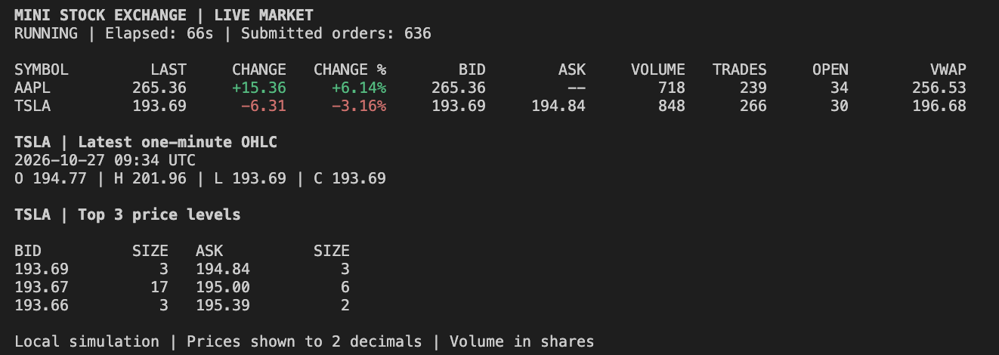

# Verdex · MiniStockExchange

**Verdex** is the web interface for this project. The Java packages, Maven artifact, and repository retain the MiniStockExchange name.

A concurrent Java stock-exchange simulator with price-time matching, limit/market orders, partial fills, amendments, cancellation, and a PostgreSQL-backed REST API.

**Current state:** React dashboard with searchable external stock quotes and historical charts from Alpaca’s IEX feed. PostgreSQL-backed local sandbox trading, accounts, and order management remain separate. Symbol search, saved watchlists, in-app alerts, a local paper portfolio, admin stock registration, and a market-session indicator are implemented. Live push updates and deployment are next.

Java 17+ · Maven · Spring Boot · Spring Security · PostgreSQL 17 · JPA/Hibernate · Flyway · JUnit

## Hosting preparation

Verdex now has a Docker build and a Render Free + Neon Free deployment configuration. The built React frontend can be served by Spring Boot from the same origin. This is **prepared, not yet deployed**; the production writer-handoff implementation still requires review before public trading. See [deployment setup and remaining launch checks](docs/DEPLOYMENT.md).

## Project evolution

These are milestones of the **same project**, not separate applications or release tags:

| Milestone | What it added |
| --- | --- |
| **V1 — Matching core** | Price/FIFO priority, partial fills, trades, cancellation, statistics, unique IDs, and thread safety. |
| **V2 — Multi-stock simulator** | Amendments, multiple stocks, market orders, lifecycle status, indexed lookup, depth, VWAP, OHLC, price changes, simulator, and console dashboard. |
| **V3 — Persistent web backend** | PostgreSQL, users, session authentication, admin controls, secured trading APIs, restart recovery, delta persistence, and public market-data APIs. Stock selection, summaries, depth, recent trades, and candlestick charts ready; account registration/login/logout ready; order submission, My Orders, and amend/cancel controls ready. |

Flyway migration numbers (`V1__...`, etc.) are separate from these milestones. The Maven artifact remains `1.0.0-SNAPSHOT`.



*V2 console demo. It uses separate in-memory markets; it does not populate the V3 database or APIs.*

## Features and architecture

- Price-time matching at the resting order's price, with FIFO queues and partial fills.
- Market orders execute available liquidity and cancel their remainder.
- Amendments preserve priority for same-price reductions; price changes/increases lose priority.
- Session login, CSRF protection, user-owned orders, and admin overrides.
- Atomic order/trade persistence, restart recovery, and failure reconciliation.
- Public snapshots, depth, paginated trades, and UTC one-minute candles.

```text
TradingController / MarketDataController
                  ↓
            TradingService
         global synchronization
            ↙           ↘
     MatchingEngine   PostgreSQL
      current book    durable history
```

Packages: `auth/` security, `user/` accounts, `stock/` metadata, `trading/` commands/persistence/recovery, `marketdata/` local read APIs, and `externalmarket/` isolated Alpaca client/cache/DTOs. External reads never mutate the matching engine or PostgreSQL. Root classes contain the matching core, console demo, and Boot entry point. Tests mirror the feature packages.

## Quick start

Requires **JDK 17+ and PostgreSQL 17**, with separate development/test databases. For a fresh checkout:

```bash
git clone https://github.com/xMisho/MiniStockExchange.git
cd MiniStockExchange
cp .env.example .env
chmod 600 .env
```

Set `DB_USERNAME`, `DB_PASSWORD`, `DB_URL`, and `DB_TEST_URL` in `.env`; database creation instructions are below. Do not overwrite an existing working `.env`.

```bash
./mvnw clean verify
./mvnw spring-boot:run
```

Check `http://localhost:8080/api/health`. Stop with **Ctrl+C**. Use `mvnw.cmd` on Windows.

Fresh databases have no seeded users/stocks/trades. Register an account, promote an administrator explicitly, register stocks, then submit orders. Empty local market responses are expected before sandbox activity. External quotes and charts use the independently configured Alpaca connection below.

For the separate console demo, after building:

```bash
java -Ddashboard.clear=true -cp target/mini-stock-exchange-1.0.0-SNAPSHOT.jar com.misho.exchange.Main 30 100 42 TSLA
```

Arguments: duration in seconds, order interval in milliseconds, random seed, selected stock. Defaults: `10 100 42 AAPL`.

## Frontend development

All external chart ranges fit their real available bars across the panel on initial load and Reset view. Polling preserves the user’s zoom; sparse latest-session data still shows a limited-data notice. No fake trades or idle bars are added. Chart wheel gestures scroll the page. Drag pans the chart; explicit +/− and Reset view buttons control its scale. Vertical touch gestures also remain available for page scrolling.

The React + TypeScript app lives in `frontend/`, with Vite, strict type checking, plain CSS, and TradingView Lightweight Charts. Use **Node 24 LTS** (`frontend/.nvmrc`). The app shell separates **Markets**, **Local Exchange**, and **My Orders**, with active navigation and browser back/forward support. Markets shows external AAPL/TSLA prices, IEX session statistics, and candlestick/close-price charts. Local Exchange puts its local chart beside order entry, followed by local depth/trades and order history. My Orders provides a dedicated history view. Trading state stays mounted across view changes, preserving drafts, in-flight requests, and uncertainty blocks. Successful actions show dismissible eight-second notifications; uncertain outcomes remain visible until reviewed.

### External market-data setup

Add your Alpaca credentials to the private **root** `.env`, then restart Spring:

```properties
ALPACA_API_KEY=your-key
ALPACA_API_SECRET=your-secret
```

The alternative names `ALPACA_API_KEY_ID` and `ALPACA_API_SECRET_KEY` are also supported. Never put provider credentials in frontend files or `VITE_*` variables. The server uses the fixed HTTPS market-data host and IEX feed; it sends credentials in headers and does not call broker order endpoints. Provider keys are not returned by the API.

- Quotes include the latest reported trade and its UTC timestamp, bid/ask, previous session close, change, and session statistics. Closed markets can show the last trading session; polling does not make an old trade current.
- IEX covers one exchange. Its volume, quotes, and previous close are not consolidated US-market figures.
- Chart ranges: latest available session (one-minute bars), one month (hourly bars), and one year (daily bars). Historical requests deliberately exclude the newest 15 minutes. Latest-session lookup searches ten calendar days; bars are split adjusted and returned chronologically without invented idle bars.
- Symbol search uses Alpaca’s active, tradable US-equity catalog, cached for 12 hours. The paper-account `/v2/assets`, `/v2/clock`, and `/v2/calendar` endpoints are used read-only; no provider orders are submitted. Search returns at most 20 results, and symbols are verified against this catalog.
- Session status uses provider clock/calendar data, including holidays and early closes, with America/New_York timezone conversion. Extended-hours labels describe time outside the regular session; they do not guarantee IEX data availability.
- Server caches quotes for 15 seconds and history for 60 seconds, shared across browser requests. The shared response cache is capped at 256 entries and provider requests at 150 per minute per backend instance. At most six watchlist preview cards poll quotes. Provider failures back off for 60 seconds; the last successful response can be served for up to 15 minutes with an explicit stale warning and fetch timestamp. Without data or credentials, show an error/setup state, never simulated replacement prices.
- Browser polling pauses in hidden tabs, cancels obsolete requests on stock changes, and preserves chart zoom on refresh. Quote and chart failures are independent.
- Check provider entitlements and redistribution permissions before public hosting. This integration is configured for local use; it does not establish a brokerage connection.

**Local sandbox orders remain separate:** they match the application's own resting orders, do not route to Alpaca, and do not automatically execute at external quotes. Local book/depth/trades/candles are in the separate Local Exchange view. The standalone V2 console is still a third, in-memory demo.

Start Spring from the repository root in one terminal:

```bash
./mvnw spring-boot:run
```

In another terminal:

```bash
cd frontend
npm ci
npm run dev
```

Open **http://localhost:5173**. Vite proxies relative `/api` requests to Spring at `http://localhost:8080`. After changing root credentials, restart Spring; Vite can stay running. Missing values display as `—`, zero counts as `0`, and provider errors have independent retry controls. Charts have candlestick and close-price views, volume bars, UTC timestamps, and an expandable provider-bar table. Symbol search supports Down/Up arrows, Enter selection, Escape, and focus restoration. Portfolio tables are keyboard-focusable for horizontal scrolling on small screens; mobile controls retain visible focus and touch targets.

Registration/login/logout use existing session and CSRF handling. Forms include accessible dialogs, focus restoration, and a show-password control. My Orders uses server pagination, responsive rows, and backend-confirmed amendments/cancellation. Unknown mutation outcomes require checking history before resubmission; orders are never automatically retried.

Frontend code is grouped into `api/` requests/validation, `types/` contracts, `components/` stock list and summary, `pages/` dashboard state, and `utils/` display formatting. API tests run in Node; React interaction tests run in jsdom, including rapid switching and unmount cleanup.

To use a different development backend, copy `frontend/.env.example` to `frontend/.env.local`, set `BACKEND_URL`, and restart Vite. This server-only setting is not bundled into the browser. Frontend env files stay separate from the root `.env`; never place database passwords in `VITE_*` variables.

```bash
npm run typecheck
npm run lint
npm test
npm run build
```

`npm run preview` serves the built static files on port 4173 for inspection; it does not configure an API proxy. Production hosting and API routing will be added with deployment. Both development servers bind to localhost. Dependencies are locked in `frontend/package-lock.json`; generated `node_modules/` and `dist/` are ignored by Git.

## Trading workspace

The local ticket includes a **Trade stock** selector synchronized with the local chart, quotes and book; it lists all registered local stocks. Administrators can add symbols using **Admin · Register local stock**. It shows **Local simulated exchange** bid/ask, paper cash and signed holdings. These balances are informational, not reserved buying power: short positions and negative cash remain possible. External market · IEX prices never determine local fills.

- Limit orders show an estimated quantity × limit value. Clicking a local bid/ask copies its exact price into the limit field without submitting or changing BUY/SELL.
- Market tickets preview all opposite-side local price levels, including levels beyond the five displayed. Estimates include fillable quantity, unfilled remainder, notional, average/worst price and observation time. They refresh while the ticket is active; prices/liquidity can change before submission. The unfilled market remainder is cancelled.
- **Order activity** expands on demand in My Orders: submission, individual executions, recorded amendments and cancellation. The endpoint returns the latest 100 events, newest first; remaining/filled totals always come from the order. Detailed actions start with migration V9; previous amendments cannot be reconstructed.
- A manual first-trade guide explains a resting sell and matching buy. No demo orders are created automatically. Same-account self-trades net to zero in the paper portfolio.
- Mobile layout prioritizes chart → ticket → book → orders. Price/quantity changes use restrained flashes, respect reduced motion, and preserve cached values through refresh failures.

New authenticated read endpoints:

| Method | Path | Purpose |
| --- | --- | --- |
| GET | `/api/stocks/{symbol}/order-preview?side=BUY&quantity=5` | Read-only full-book market-fill estimate; no reservation or execution |
| GET | `/api/orders/{id}/lifecycle` | Owner/admin activity; does not expose counterparty order/user IDs |

Order actions are inserted in the same PostgreSQL transaction as order changes and fills. Rollback removes the audit action too; post-commit recovery never replays it. Failed requests are not recorded as successful actions. No push transport or automated retry was added.

## Personal market tools

- **Saved watchlists:** authenticated users can save up to 20 external instruments. Favorites persist in PostgreSQL and are private to that account. AAPL/TSLA remain starter cards when no favorites are saved.
- **Price alerts:** choose the alert stock independently of the chart using the Alert stock dropdown (Apple/Tesla and watchlist entries) or Find alert stock provider search. Up to 20 alerts per account, targeting an observed crossing ABOVE/BELOW a price. Arming records the latest provider price and timestamp. A later, newer trade must cross the threshold; already-passed targets do not fire immediately. Alerts evaluate only while the Markets page polls, and cannot reconstruct missed prices between samples. Stale responses are skipped, triggered alerts persist with an explicit badge, and newly triggered alerts show a dismissible ten-second in-app toast once. Historical triggers do not replay notifications when the panel reopens. Unavailable checks show a warning. There is no background worker, email, or push delivery.
- **Paper portfolio:** uses $100,000 virtual starting cash and replays committed local trades by trade ID. Signed holdings, average cost, realized/unrealized P/L, cash, and equity use local execution marks, never external Alpaca prices. It is an accounting view of existing matching, with no new cash/holding enforcement: negative cash and short positions are possible. Self-trades net to zero; cancelled/resting orders do not affect the portfolio. Historical replay grows with executed history; this is not a brokerage ledger.
- **Admin registration:** Local Exchange includes an ADMIN-only form for adding local stocks with a reference price. The existing server-side ADMIN and CSRF checks remain authoritative; registration does not create an externally listed security.

Watchlists and alerts use Flyway **V8** (`exchange.watchlist`, `exchange.price_alerts`). Portfolio values are derived, so there is no separate balance table that can drift from executions.

## REST API

Public GETs require no login or CSRF. Security failures distinguish `AUTHENTICATION_REQUIRED` (401), `ACCESS_DENIED` (403 permission failure), and `CSRF_INVALID` (403 missing/invalid security token). GET permission errors do not claim a CSRF problem. All mutations require CSRF; trading requires login, and stock registration requires ADMIN. Login is form-encoded; other request bodies are JSON.

| Method | Path | Access / purpose |
| --- | --- | --- |
| GET | `/api/market/search?q=NVDA` | Public provider instrument search, max 20 results |
| GET | `/api/market/session` | Public provider calendar/clock status |
| GET/POST | `/api/watchlist` | Authenticated own watchlist / add `{symbol}` |
| DELETE | `/api/watchlist/{symbol}` | Authenticated remove own favorite |
| GET/POST | `/api/alerts` | Authenticated evaluate/list own alerts / create `{symbol,direction,target}` |
| DELETE | `/api/alerts/{id}` | Authenticated delete own alert; unknown/other owner gives 404 |
| GET | `/api/portfolio` | Authenticated own local paper portfolio |
| GET | `/api/market/instruments` | Public external watchlist and connection configuration status |
| GET | `/api/market/{symbol}/quote` | Public external Alpaca/IEX quote and source metadata |
| GET | `/api/market/{symbol}/candles?range=1D` | Public external bars; range `1D`, `1M`, or `1Y` |
| GET | `/api/health` | Public web health |
| GET | `/api/auth/csrf` | Public token/header-name lookup |
| POST | `/api/users` | Public user registration |
| POST | `/api/auth/login` | Public form-encoded login |
| GET | `/api/auth/me` | Authenticated profile |
| POST | `/api/auth/logout` | CSRF-protected session logout |
| GET | `/api/stocks` | Public metadata list, sorted by symbol |
| GET | `/api/stocks/{symbol}` | Public stock metadata |
| POST | `/api/stocks` | ADMIN-only stock registration |
| GET | `/api/stocks/{symbol}/snapshot` | Public local sandbox summary |
| GET | `/api/stocks/{symbol}/depth` | Public local sandbox resting quantities |
| GET | `/api/stocks/{symbol}/trades` | Public local sandbox committed executions |
| GET | `/api/stocks/{symbol}/candles` | Public local sandbox one-minute OHLC |
| POST | `/api/stocks/{symbol}/orders` | Authenticated order submission |
| GET | `/api/orders/me` | Authenticated caller's paginated history |
| GET | `/api/orders/{id}` | Owner or ADMIN lookup |
| PATCH | `/api/orders/{id}` | Owner or ADMIN amendment |
| DELETE | `/api/orders/{id}` | Owner or ADMIN cancellation |

## Testing and performance

```bash
./mvnw clean verify
./mvnw -Dtest=TradingBenchmarkTest -Dtrading.benchmark=true test
```

Integration tests use real PostgreSQL in `DB_TEST_URL`; the opt-in benchmark is skipped in normal runs. Coverage includes matching, security, ownership, pagination, market data, concurrency, transaction failures, and restart recovery.

Local median latency at **20,000 historical orders / 10,000 trades**:

| Operation | Before → after delta persistence |
| --- | ---: |
| Submit | 176.371 → 1.159 ms |
| Amend | 166.812 → 4.271 ms |
| Cancel | 154.125 → 3.909 ms |
| Executing market order | 179.097 → 6.939 ms |

Measured 2026-10-29 with five warmup and ten measured cycles; baseline `5dee98c`. Local results demonstrate reduced history-replay cost, not a production throughput guarantee.

## Important limits

- **One active backend writer.** Global synchronization remains intentional; cached engines are not coordinated across instances.
- A failed mutation may already have committed. On `TRADING_OUTCOME_UNCERTAIN` / `retrySafe: false`, inspect history before retrying. No request-idempotency keys yet.
- Recovery failure blocks that market. Historical reads remain available if PostgreSQL works.
- Engine history grows in memory; depth/candle query work is not fully bounded by response limits.
- No funded balances, settlement, or broker order routing. The paper portfolio is a derived simulation accounting view. External market data does not determine local sandbox fills.
- Local development only for now. SSE, Docker deployment, and further production hardening remain planned.

## Detailed guides

Expand only what you need:

<details>
<summary>PostgreSQL setup and backend launch</summary>

##### Requirements

- JDK 17 or newer.
- PostgreSQL 17 running locally, with separate development and test databases.
- The Maven wrapper downloads Maven on first use; a separate Maven installation is optional.
- `curl` and Python 3 for the optional terminal walkthrough below.

Clone the repository:

```bash
git clone https://github.com/xMisho/MiniStockExchange.git
cd MiniStockExchange
```

For a **new PostgreSQL installation**, connect using an authorized database administrator:

```bash
psql -d postgres
```

Create the application login and databases. `\password` prompts instead of embedding the password in SQL history:

```sql
CREATE ROLE mini_stock_exchange LOGIN NOSUPERUSER NOCREATEDB NOCREATEROLE;
\password mini_stock_exchange
CREATE DATABASE mini_stock_exchange OWNER mini_stock_exchange;
CREATE DATABASE mini_stock_exchange_test OWNER mini_stock_exchange;
\q
```

For a fresh checkout, create your private configuration, then edit `.env` and replace its password placeholder:

```bash
cp .env.example .env
chmod 600 .env
```

Do not overwrite an existing working `.env` or recreate databases you already use.

| Variable | Purpose |
| --- | --- |
| `DB_URL` | Application JDBC URL; defaults to `jdbc:postgresql://localhost:5432/mini_stock_exchange` |
| `DB_TEST_URL` | Integration-test URL; defaults to `jdbc:postgresql://localhost:5432/mini_stock_exchange_test` |
| `DB_USERNAME` | Application database login; defaults to `mini_stock_exchange` |
| `DB_PASSWORD` | Password for that database login, not a web user's password |
| `SESSION_COOKIE_SECURE` | Set to `true` when serving over HTTPS; defaults to `false` for local HTTP |

Launch from the repository root so Spring can read `.env`, or supply environment variables explicitly. Environment variables override file values. `.env` is ignored by Git; `.env.example` contains placeholders only. No real accounts, credentials, or database records are distributed in the repository.

On the original Apple Silicon/Homebrew installation, the server can be controlled with:

```bash
/opt/homebrew/opt/postgresql@17/bin/pg_ctl -D /opt/homebrew/var/postgresql@17 -l /opt/homebrew/var/postgresql@17/server.log -w start
/opt/homebrew/opt/postgresql@17/bin/pg_ctl -D /opt/homebrew/var/postgresql@17 -m fast -w stop
```

Other installations should use their own PostgreSQL service controls. Only stop a server when other local applications no longer need it. pgAdmin is an optional visual client, not a server dependency; tables are under `mini_stock_exchange → Schemas → exchange → Tables`.

##### Run the web backend

```bash
./mvnw spring-boot:run
```

Open these public endpoints:

```bash
curl http://localhost:8080/api/health
curl http://localhost:8080/api/stocks
```

The health response is `{"status":"UP"}`. It checks web responsiveness, not continuous database health. Startup requires PostgreSQL, valid migrations, and successful market recovery. The default development backend does not serve the frontend at `/`; use Vite, or build the combined application with the Maven `production` profile as described in [deployment setup](docs/DEPLOYMENT.md). Stop Spring with **Ctrl+C**; PostgreSQL continues running separately.

Build and run the packaged backend:

```bash
./mvnw clean verify
java -jar target/mini-stock-exchange-1.0.0-SNAPSHOT-boot.jar
```

Use `mvnw.cmd` instead of `./mvnw` on Windows. Integration tests require the dedicated test database; there is no H2 fallback.

</details>

<details>
<summary>Registration, session login, CSRF, and administrator setup</summary>

The backend uses Spring Security **session cookies**, not JWTs. Usernames and emails are trimmed and normalized to lowercase. Usernames accept 3–50 letters/digits/underscores; email format is validated but ownership is not verified. Passwords are preserved exactly, must contain 15–128 characters, and must not be entirely blank.

Passwords are hashed before storage with PBKDF2-HMAC-SHA256, 600,000 iterations, a random 16-byte salt, and a 256-bit derived key. Responses never expose raw passwords or hashes. Authentication loads credentials from PostgreSQL and checks the stored hash through Spring Security.

Registration creates a `USER`; it does not log the account in. Supplying a role in the registration payload cannot create an administrator.

##### Browser account flow

Use **Create account** or **Sign in** in the React header. Registration creates a regular user and then prompts for login. The header restores the session with `/api/auth/me` on startup and rechecks it on window focus or when the tab becomes visible; authenticated requests reporting `401` clear the local account state. Network failures show a session-check retry instead of claiming you are logged out. The username and role appear after login. Passwords and tokens are never written to localStorage or sessionStorage; the server manages cookies. **Remember me for 14 days** is opt-in and unchecked by default. It issues a persistent HttpOnly, SameSite=Lax cookie with opaque random tokens stored in `exchange.persistent_logins`. The cookie uses the same `SESSION_COOKIE_SECURE` setting as sessions. Logout clears it and revokes the user’s remembered tokens. Automatic restoration runs through `GET /api/auth/me`, reloads current roles, rotates the token, and creates a fresh session; public dashboard requests do not consume or rotate it. Tampered/replayed tokens are rejected. Remembered-login tokens expire after 14 days without restoration; expired rows are pruned when new tokens are issued. A later login without the checkbox clears that browser’s remembered cookie.

One shared helper fetches a fresh CSRF token before each mutation; login/logout additionally request a new token after the session changes. Failed mutations are never automatically retried. If the post-login/logout token fetch fails, the completed session change stays visible with a warning; the next mutation obtains its own fresh token.

### Terminal walkthrough

Use the same terminal for these commands so the cookie/token variables stay available. Example credentials below are demonstration data only.

Get a session and CSRF token:

```bash
COOKIE_JAR=$(mktemp)
CSRF_TOKEN=$(curl -sS -b "$COOKIE_JAR" -c "$COOKIE_JAR" http://localhost:8080/api/auth/csrf | python3 -c 'import json,sys; print(json.load(sys.stdin)["token"])')
```

Register, then log in. Registration is JSON; login is form-encoded:

```bash
curl -i -b "$COOKIE_JAR" -c "$COOKIE_JAR" http://localhost:8080/api/users \
  -H "X-CSRF-TOKEN: $CSRF_TOKEN" -H 'Content-Type: application/json' \
  -d '{"username":"example_user","email":"example_user@example.test","password":"ExampleOnlyPassword123!"}'

curl -i -b "$COOKIE_JAR" -c "$COOKIE_JAR" http://localhost:8080/api/auth/login \
  -H "X-CSRF-TOKEN: $CSRF_TOKEN" \
  --data-urlencode 'username=example_user' \
  --data-urlencode 'password=ExampleOnlyPassword123!'
```

Login uses the username, not email. On success, it rotates the session ID and invalidates the old CSRF token. Fetch a fresh token before any subsequent write:

```bash
CSRF_TOKEN=$(curl -sS -b "$COOKIE_JAR" -c "$COOKIE_JAR" http://localhost:8080/api/auth/csrf | python3 -c 'import json,sys; print(json.load(sys.stdin)["token"])')
curl -i -b "$COOKIE_JAR" http://localhost:8080/api/auth/me
```

To create the first administrator, an authorized operator must promote an existing account in the development database:

```sql
UPDATE exchange.users SET role = 'ADMIN' WHERE username = 'example_user';
```

Log out and back in after promotion, then refresh CSRF again. Roles are captured at login; changing a database role does not update an existing session. No public role-management endpoint or automatic administrator exists.

Log out with the current token:

```bash
curl -i -b "$COOKIE_JAR" -c "$COOKIE_JAR" -X POST http://localhost:8080/api/auth/logout \
  -H "X-CSRF-TOKEN: $CSRF_TOKEN"
rm "$COOKIE_JAR"
```

Logout returns `204`, invalidates the session, and expires its cookie. Obtain a fresh anonymous token before logging in or registering again. Cookies are HttpOnly and SameSite=Lax, sessions expire after 30 minutes of inactivity, and sessions do not survive server restarts. An opted-in remembered-login cookie can restore a new session through `/api/auth/me` after expiry or restart; it never stores your password. Fresh CSRF tokens are still required for writes. URL session tracking and HTTP Basic are disabled.

</details>

<details>
<summary>API payloads, pagination, candle semantics, and errors</summary>

##### Stock metadata and trading

The React trading section requires login. Choose BUY/SELL, LIMIT/MARKET, and a positive whole quantity; MARKET disables price and omits it from the request. LIMIT prices accept up to four decimal places. Validated price text is serialized directly as an exact JSON number rather than rounded through JavaScript arithmetic. Successful submission displays the returned order ID/status and filled/remaining shares.

My Orders uses server-side pagination (25 per page) and status filters, including all stocks owned by the caller. It is refreshed manually or after that caller’s mutations; external fills appear on the next history refresh. Open and partially filled LIMIT rows expose amendment and cancellation; terminal orders have no controls. Amendment requires both a new price and a new **remaining** quantity. Invalid inputs receive focus with an associated inline error. Server amendment errors stay visible inside the dialog, and pending requests disable its close/save controls. No trading state is changed optimistically. Successful mutations reload history and request fresh snapshot/depth/trades/candles for the affected stock, queuing that refresh if a read is already in flight.

Mutations are never automatically replayed. A lost response, unreadable success body, or uncertain server result displays a warning and pauses further mutations until the user checks My Orders and explicitly acknowledges that review. This browser safeguard is not an idempotency key and does not survive a page reload. Do not blindly resubmit after reloading either. Failed CSRF preparation sends no mutation. Account changes/sign-out are disabled while an order request is pending; `401` still clears the local session. Admins’ My Orders also shows only their own orders.


An authenticated ADMIN can register a stock using JSON:

```json
{"symbol":"AAPL","companyName":"Apple Inc.","referencePrice":100.00}
```

This is an illustrative reference price, not a market quote. Symbols normalize to uppercase. Duplicate registration returns `409` and cannot overwrite an existing stock. Prices must fit `NUMERIC(19,4)` exactly; values requiring rounding are rejected. Fresh sandbox databases are empty. These stock reference prices and sandbox execution prices are separate from the external Alpaca dashboard feed.

After logging in, this command submits a resting SELL order for an already registered symbol:

```bash
curl -i -b "$COOKIE_JAR" http://localhost:8080/api/stocks/AAPL/orders \
  -H "X-CSRF-TOKEN: $CSRF_TOKEN" -H 'Content-Type: application/json' \
  -d '{"side":"SELL","type":"LIMIT","limitPrice":101.00,"quantity":5}'
```

Submit a crossing BUY to execute against it:

```json
{"side":"BUY","type":"LIMIT","limitPrice":105.00,"quantity":2}
```

Submission returns `201` with the resulting order and a `Location: /api/orders/{id}` header. Database-generated IDs are used by the engine. Ownership always comes from the login session, never a client-supplied owner ID. Public order responses omit internal FIFO priority and optimistic-lock versions.

Market orders have no limit price:

```json
{"side":"BUY","type":"MARKET","quantity":5}
```

They execute against available opposite-side limits, best price first, and cancel unfilled remainder. They never rest in the book.

Amend an open limit order with PATCH:

```json
{"newPrice":102.00,"newRemainingQuantity":3}
```

Quantity means **new remaining quantity**, not original quantity. Original quantity and creation timestamp remain historical. Same-price reductions keep FIFO position; increases or price changes move the order to the back. A same-price/same-quantity amendment succeeds as a no-op. Crossing amendments match immediately. Zero quantity is invalid; use cancellation instead. Amendment/cancellation returns `204`, or `409` for a terminal order.

`/api/orders/me?page=0&size=25&status=OPEN` supports an optional `OPEN`, `PARTIALLY_FILLED`, `FILLED`, or `CANCELLED` filter. Results use descending order ID. Defaults are page 0 and size 25; size must be 1–100 and page nonnegative. Offsets beyond the persistence provider's integer range are rejected. The list always belongs to the caller, including for admins. Admins can separately inspect/amend/cancel another owner's order without changing ownership; ordinary users receive `403` for someone else's known order.

##### Snapshot and depth

```bash
curl http://localhost:8080/api/stocks/AAPL/snapshot
curl 'http://localhost:8080/api/stocks/AAPL/depth?levels=3'
```

Snapshot fields are `symbol`, `lastTradedPrice`, `priceChange`, `priceChangePercent`, `bestBidPrice`, `bestAskPrice`, `spread`, `volume`, `tradeCount`, `openOrderCount`, and `vwap`. The dedicated response DTO omits internal depth/candle fields.

Last price changes only on execution. Price change is last price minus reference price; percentage change uses the reference as denominator. This is not necessarily a daily change. VWAP is the sum of execution price × executed quantity divided by total quantity, rounded to four decimals. Executed volume counts shares once per trade, not both sides. Open-order count counts orders, not shares.

Before trading, last price/change/VWAP are null. Quotes can exist without trades; missing sides are null, and spread is null unless both sides exist. An entirely empty market has zero counters.

Depth response:

```json
{"symbol":"AAPL","bids":[{"price":99.00,"quantity":12}],"asks":[{"price":101.00,"quantity":8}]}
```

Bids descend and asks ascend by price. Quantities are `long` sums of remaining shares at each numeric price. `levels` defaults to 3 and must be 1–100 per side. Empty sides return `[]`. Both sides come from one immutable snapshot under the service monitor. Responses are bounded, although the internal snapshot still aggregates the full open book.

##### Trade history and candles

```bash
curl 'http://localhost:8080/api/stocks/AAPL/trades?page=0&size=25'
curl 'http://localhost:8080/api/stocks/AAPL/candles?limit=100'
curl 'http://localhost:8080/api/stocks/AAPL/candles?from=2026-10-30T09:00:00Z&to=2026-10-30T10:00:00Z&limit=100'
```

Order history and trade history use the same pagination envelope:

```json
{"content":[],"page":0,"size":25,"totalElements":0,"totalPages":0}
```

Public trade items contain only `tradeId`, `symbol`, `executionPrice`, `quantity`, and `executedAt`. They never expose order or user IDs. Ordering is **trade ID descending**, even when execution timestamps tie or move backward. Page/size rules match order history. Empty histories and pages beyond the end return `200` with empty content. New inserts can shift offset-based pages between requests; pagination is not a fixed historical snapshot.

Candle response:

```json
[{"startTime":"2026-10-30T09:00:00Z","open":100.00,"high":103.00,"low":99.00,"close":102.00,"volume":20,"tradeCount":4}]
```

Candles are derived from PostgreSQL trades, with no separate candles table:

- UTC minute buckets; idle minutes are omitted.
- Open/close use first/last execution by `(executed_at, trade_id)`, with ID breaking timestamp ties.
- High/low are maximum/minimum price; volume sums quantities and trade count counts executions. Both counters use `long`.
- Optional ISO-8601 `from`/`to` accept UTC or explicit offsets. From is inclusive, to exclusive, and `from < to` when both exist.
- Execution filtering happens **before** aggregation: a partial-minute window represents only trades in that window.
- Limit defaults to 100, accepts 1–1000, and selects the **latest** buckets before returning them chronologically.
- No matching trades returns `200 []`. The current minute can still change; no final-candle flag is supplied.
- Bounds are within UTC calendar years 1–9999. Finer-than-microsecond bounds round upward for comparisons against PostgreSQL's microsecond timestamps.

Unlike the engine's execution-sequence candle replay, this historical API uses timestamp order if clocks move backward. Trade history and candles read committed PostgreSQL records and remain available when a live engine is blocked, provided the database works. Symbols are case-insensitive across market-data endpoints.

##### Errors and retries

| Status | Meaning |
| --- | --- |
| `400` | Invalid payload, symbol, pagination, or time range |
| `401` | Authentication required / invalid login |
| `403` | Ownership/access denied or missing/invalid CSRF |
| `404` | Unknown stock/order |
| `409` | Duplicate registration or amendment/cancellation of a terminal order |
| `503` | Market/database unavailable, or uncertain trading outcome |

A mutation failure can occur **after PostgreSQL committed**. The response then uses `TRADING_OUTCOME_UNCERTAIN` with `retrySafe: false`. Check your order history and relevant order before retrying; no automatic retry or request-idempotency key is implemented. A lost HTTP response can also hide a successful submission. If durable history cannot be read, wait for recovery rather than blindly resubmitting.

</details>

<details>
<summary>File organization, database integrity, and recovery guarantees</summary>

Source lives under `src/main/java/com/misho/exchange/`; tests mirror feature packages under `src/test/java/com/misho/exchange/`.

| Package / files | Responsibility |
| --- | --- |
| Root matching classes | Framework-independent `Order`, `OrderBook`, `Trade`, `MatchingEngine`, `Stock`, `Exchange`, enums, and immutable snapshots |
| Root console classes | `Main`, `MarketSimulator`, `ConsoleDashboard`; standalone simulation and rendering |
| Root Boot entry / health | `MiniStockExchangeApplication`, `HealthController` |
| `auth/` | Spring Security session rules, login/logout wiring, CSRF, current-user endpoint |
| `user/` | Registration, password configuration, database credentials/roles, safe user responses |
| `stock/` | Stock metadata entity, repository, service, validation, and REST API |
| `trading/` | Order/trade persistence, authenticated commands, ownership, transactions, engine registry, and recovery |
| `marketdata/` | Public read controller, DTOs, error handling, and SQL candle aggregation |
| `src/main/resources/db/migration/` | Append-only Flyway schema/index migrations |
| `src/test/.../support/` | HTTP session/CSRF test client |
| `assets/` | README dashboard screenshot |

```text
Authenticated commands ── TradingController ──┐
                                             ▼
                                     TradingService
                                  global synchronization
                                     /           \
                          MatchingEngine       PostgreSQL
                           current book       orders + trades
                                             ▲
Public market data ── MarketDataController ────┘
                      snapshots/depth: engine
                      history/candles: database
```

Controllers stay thin and return DTOs. `TradingService` remains the coordination boundary for both paths, including historical reads. `CandleRepository` uses parameterized SQL; order/trade repositories use JPA. The matching core and console launcher retain their original package/API so existing console commands continue to work.

## Persistent trading and recovery

The highest bid and lowest ask match when prices cross. Each price level is a FIFO `ArrayDeque` inside a `TreeMap`. Executions use the resting order's price; partial fills leave remaining LIMIT quantity in the book. The ID index speeds open-order lookup; removal still scans the selected queue.

The web service holds one global monitor through validation, engine mutation, database commit, and recovery/publication. A PostgreSQL advisory transaction lock also serializes participating database transactions; lock waiting is limited to five seconds. Successful writes reuse the engine, fetch only affected rows, and persist the target, changed counterparties, and new trades atomically. They do not replay or copy all historical orders/trades.

**Invariant: whenever the service monitor is released, every available engine reflects committed database state.** PostgreSQL rollback cannot undo Java memory, so failure triggers reconstruction from actual committed history before releasing the monitor. Commit may already have succeeded; recovery does not reexecute the command. If reconstruction fails, the cached engine is removed and the market is blocked until explicit recovery or successful restart. Recovery is attempted for runtime exceptions and errors; process termination/resource exhaustion can still prevent in-process recovery.

Startup restores active LIMIT orders by `priority_sequence`, not creation time, preserving amendment priority. It reserves terminal IDs, restores quantities/status/timestamps, and replays trades for last price, volume, VWAP, and engine candles. Recovery does not create executions. It rejects crossed resting books, unfinished MARKET orders, invalid references, and fill totals inconsistent with trade history.

| Database object | Purpose |
| --- | --- |
| `exchange.stocks` | Symbol, company name, fixed reference price |
| `exchange.users` | ID, normalized username/email, password hash, registration time, role |
| `exchange.orders` | Owner, symbol, side/type, price, original/remaining/filled quantities, status, priority, timestamps, version |
| `exchange.trades` | Symbol, buy/sell order references, execution price/quantity/time |
| `exchange.order_actions` | Durable submission, amendment and cancellation activity |
| `exchange.market_writer` | Production deployment ownership for one active matching writer |
| Priority sequence | Queue order across submissions and priority-losing amendments |

Original quantity remains historical after amendments, so it need not equal filled plus remaining. CANCELLED orders retain unfilled remaining quantity. Trade foreign keys enforce distinct BUY/SELL orders for the same stock. Order versions reject stale database updates. Engine fills use checked integer addition.

Flyway migrations: **V1** schema, **V2** stocks, **V3** users, **V4** roles, **V5** orders/trades, **V6** trade time-range index, **V7** remembered-login tokens, **V8** watchlists/alerts, **V9** order action history, **V10** production writer ownership. Flyway records applied migrations in `public.flyway_schema_history`; add new migrations instead of editing applied ones. Hibernate validates the schema (`ddl-auto=validate`), Open Session in View is disabled, and Flyway clean is disabled.

This design supports **one active backend writer**. The advisory lock does not synchronize cached engines across multiple instances. The production profile additionally checks database writer ownership under that same transaction lock: a replacement atomically restores state and claims ownership, and superseded instances reject trading/cached-book reads. This is a fail-closed deployment handoff, not horizontal scaling; see [recovery procedures](docs/DEPLOYMENT.md#recovery-procedure). All persisted trading must go through `TradingService`; direct repository/SQL changes during trading are unsupported except deliberate maintenance followed by recovery. The service rejects ambient transactions so a caller cannot later roll back data after publication.

</details>

<details>
<summary>Console controls and simulator behavior</summary>

Build first, then run the separate V2 simulation:

```bash
./mvnw package
java -Ddashboard.clear=true -cp target/mini-stock-exchange-1.0.0-SNAPSHOT.jar com.misho.exchange.Main 30 100 42 TSLA
```

| Argument | Meaning | Default |
| --- | --- | --- |
| First | Duration in seconds | `10` |
| Second | Interval between generated orders in milliseconds | `100` |
| Third | Random seed, with no unit | `42` |
| Fourth | Symbol shown in detail | `AAPL` |

The console creates AAPL/TSLA with illustrative reference prices 250/200. It generates approximately 75% LIMIT and 25% MARKET orders, with limits roughly ±1% around last execution or reference price. It fetches no external quotes. Generated IDs skip previously used IDs; a simulator-owned open-order cap cancels its oldest open order before another limit submission. The cap does not restrict other participants.

The dashboard refreshes each second, displays two-decimal prices/VWAP, a selected-stock UTC candle, and top-three depth. Live mode uses an alternate terminal screen; completion/Ctrl+C restores it. `-Ddashboard.clear=false` keeps scrolling logs. `NO_COLOR=1` or `-Ddashboard.color=false` disables color. Use an ANSI-capable terminal around 105 columns by 22 rows.

The plain JAR is launched by class name; the `-boot.jar` is the separate executable web server. `./mvnw package -DskipTests` can build the console without a database test run. Equal seeds reproduce serial order decisions for equal initial books and step counts; scheduled run counts and timestamps still depend on timing.

</details>

<details>
<summary>Test coverage and benchmark methodology</summary>

```bash
./mvnw clean verify
./mvnw -Dtest=TradingServiceTest test
./mvnw -Dtest=CandleApiTest test
./mvnw -Dtest=ConsoleDashboardTest test
```

Spring integration tests use the `test` profile and real PostgreSQL at `DB_TEST_URL`. Keep it separate from development, with a database name ending in `_test`. Tests create/delete their own fixture records. Core matching and console tests do not need PostgreSQL.

Coverage includes FIFO, partial fills, amendment priority, market-order remainder, status, ID reuse, concurrency, user/stock validation, password hashing, authentication, CSRF, ownership/admin rules, pagination, market-data isolation, UTC candle boundaries/ties, and index migrations. Persistence tests cover actual application-context restart, rollback after matching, pre/post-commit failures, publication/recovery failures, blocked markets, and readers waiting through commit/reconciliation.

Reports are in `target/surefire-reports/`. Tests establish behavior for exercised cases, not every possible failure or thread schedule.

##### Persistence benchmark

The opt-in benchmark uses the test database, cleans only its own fixtures, and is skipped during ordinary runs:

```bash
./mvnw -Dtest=TradingBenchmarkTest -Dtrading.benchmark=true test
```

It seeds 100/1,000/10,000 trades with twice as many historical filled orders, then measures resting submit, priority-losing amendment, cancellation, and executing market submit. Each size has five warmup cycles and ten measured cycles; setup, recovery, and cleanup are excluded. Run separately from other database workloads.

Local medians on 2026-10-29, at **20,000 historical orders / 10,000 trades**:

| Operation | Before delta persistence | After |
| --- | ---: | ---: |
| Resting submit | 176.371 ms | 1.159 ms |
| Amendment | 166.812 ms | 4.271 ms |
| Cancellation | 154.125 ms | 3.909 ms |
| Executing market submit | 179.097 ms | 6.939 ms |

The baseline was commit `5dee98c` with the same benchmark fixture. Results demonstrate removal of per-command history reconstruction; they are short local measurements, not a production throughput SLA. Logging, caches, JIT warmup, and machine load affect numbers. Full recovery/history reads still scale with history, and historical engine state still grows in memory.

</details>

## Project history

Extracted from [Java-Projects](https://github.com/xMisho/Java-Projects), preserving relevant Git history before Maven conversion. The original monorepo is archived. V3 builds on the existing matching core rather than duplicating it.
